# Guía de la aplicación de escritorio

La aplicación de escritorio de PhoinixDR sigue los mismos pasos que la
línea de comandos: elegir una fuente, escanear, entender lo encontrado,
previsualizar, recuperar. Nunca escribe en la fuente. La interfaz está en
inglés; esta guía indica entre paréntesis los textos que verá en pantalla.

## Inicio

<figure>
  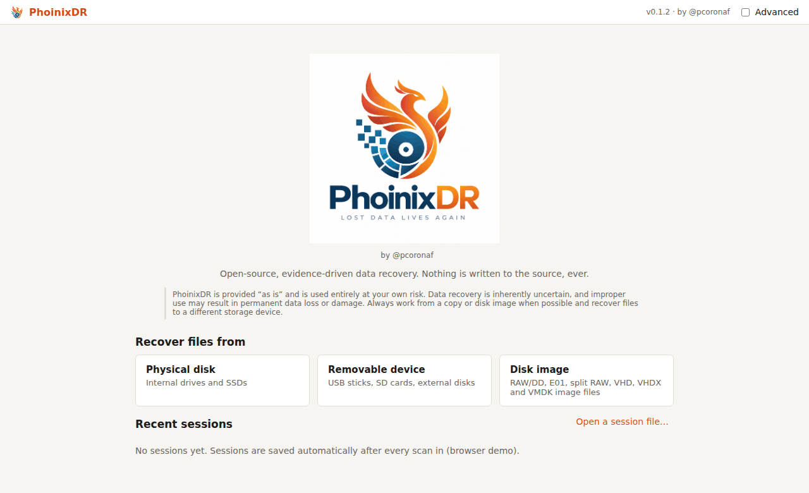
  <figcaption>La página de inicio: elija un disco físico, un dispositivo extraíble o una imagen de disco; debajo se listan las sesiones recientes.</figcaption>
</figure>

- **Windows:** ejecute `PhoinixDR-<versión>-windows-x64-portable.exe`. No se instala
  nada (véase [Versión portable para Windows](../release/windows-portable.md)).
  Para escanear un disco físico o una memoria USB, haga clic derecho en el
  ejecutable y elija *Ejecutar como administrador*; las imágenes de disco
  no lo necesitan.
- **Linux:** ejecute `phoinix-desktop`; los dispositivos físicos necesitan
  `sudo` o una regla udev que conceda acceso de lectura a los discos.

La página de inicio muestra la versión y el autor en la barra superior y
lista las sesiones de escaneo recientes. Una sesión de un dispositivo
físico se etiqueta con el modelo y el número de serie de la unidad, de modo
que los escaneos de discos distintos que ocuparon la misma ruta de
dispositivo se distinguen.

## Dos formas de recuperar

PhoinixDR puede trabajar sobre el propio dispositivo o sobre una imagen de
este. Elija una antes de empezar; el resto de esta guía vale para ambas:

1. **Directamente desde el dispositivo, en un solo paso.** Elija *Physical
   disk* o *Removable device*; cuando el dispositivo aparezca como no
   accesible, pulse **Restart as administrator** y acepte el aviso del
   sistema (o inicie PhoinixDR elevado usted mismo: Windows clic derecho,
   *Ejecutar como administrador*; Linux `sudo`). Después escanee y recupere. Es lo más rápido; PhoinixDR solo lee del
   dispositivo.
2. **Desde una imagen de disco.** Cree primero una imagen del dispositivo
   con una herramienta de adquisición (FTK Imager o Arsenal Image Mounter
   en Windows, `dd` o `ewfacquire` en Linux) y abra después el archivo de
   imagen en PhoinixDR con *Disk image*. PhoinixDR no necesita elevación
   para ello; la herramienta de adquisición sí, porque lee el mismo
   dispositivo en bruto. Es la vía recomendada para un disco que falla,
   para todo lo que quizá tenga que examinar de nuevo y para el trabajo
   forense (los hashes de un E01 se verifican y se recogen en el informe).

Las dos vías dan los mismos resultados en un dispositivo sano. En ambas,
recupere a un disco distinto del que está recuperando.

## 1. Elegir una fuente

<figure>
  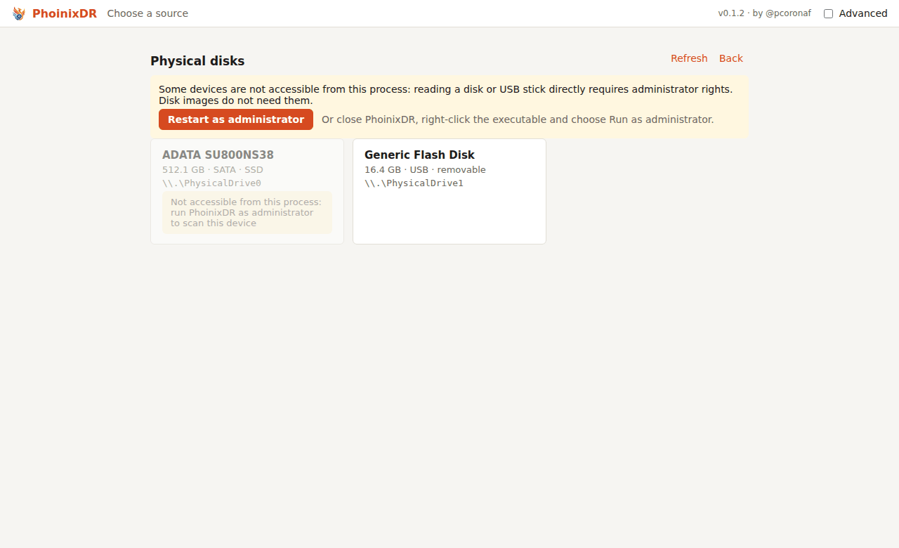
  <figcaption>El selector de dispositivos. Un disco que no puede abrirse aparece atenuado y el aviso ofrece reiniciar con permisos de administrador.</figcaption>
</figure>

| opción | qué lista |
|---|---|
| **Physical disk** (disco físico) | unidades internas y SSD |
| **Removable device** (dispositivo extraíble) | memorias USB, tarjetas SD, discos externos |
| **Disk image** (imagen de disco) | un archivo: RAW/dd, RAW dividida, E01 (y E01 dividida), SMART, VHD, VHDX, VMDK |

Un dispositivo que no puede abrirse aparece atenuado como *Not accessible
from this process* (no accesible desde este proceso), y un aviso ofrece
**Restart as administrator** (reiniciar como administrador): PhoinixDR
pide la elevación al sistema (el aviso UAC de Windows, el diálogo de
contraseña de polkit en Linux) e inicia una copia elevada de sí mismo. En
Windows la ventana actual se cierra en cuanto arranca la nueva; en Linux
permanece abierta hasta que aparece la nueva ventana. Si rechaza el aviso,
la ventana actual sigue como estaba. El mismo aviso aparece en la página de
inicio cuando no se puede listar ningún dispositivo. También puede iniciar
usted mismo el ejecutable con *Ejecutar como administrador* o `sudo`. Las
imágenes de disco nunca necesitan elevación.

## 2. Configuración del escaneo

<figure>
  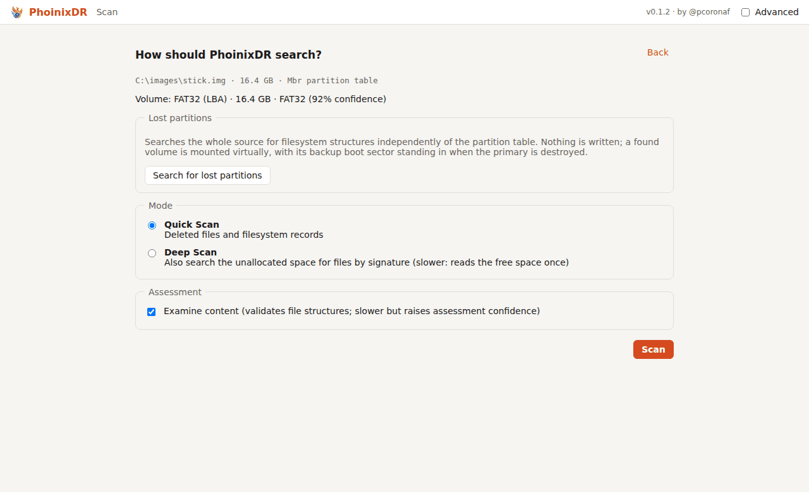
  <figcaption>Configuración del escaneo: el volumen detectado, la búsqueda de particiones perdidas, Quick o Deep Scan y el examen del contenido.</figcaption>
</figure>

La página de configuración muestra la fuente, su tabla de particiones y
cada volumen con su sistema de archivos y la confianza de la detección.

- **Image container** (contenedor de imagen; solo archivos de imagen):
  formato, variante, número de segmentos, compresión, la cabecera de
  adquisición de un E01 (número de caso, examinador, fechas, software),
  los hashes almacenados y un botón **Verify hashes** que lee la imagen
  completa y compara su MD5/SHA-1 con los almacenados.
- **Volume** (volumen): elija una partición cuando la fuente tenga varias.
- **Lost partitions** (particiones perdidas): *Search for lost partitions*
  recorre toda la fuente buscando estructuras de sistemas de archivos con
  independencia de la tabla. Un volumen encontrado puede seleccionarse y
  se monta virtualmente; cuando su sector de arranque primario está
  destruido, se usa la copia de seguridad en memoria. La tabla de
  particiones nunca se modifica.
- **Mode** (modo): *Quick Scan* lee los metadatos del sistema de archivos
  (archivos y registros borrados). *Deep Scan* además talla el espacio no
  asignado buscando archivos por firma; lee el espacio libre una vez. Los
  volúmenes sin sistema de archivos reconocido solo admiten el escaneo
  profundo.
- **Deep scan options** (opciones del escaneo profundo): tallar todo el
  volumen en lugar de solo el espacio libre; restringir los tipos de
  archivo.
- **Assessment** (evaluación): *Examine content* valida las estructuras
  de los archivos (JPEG, PNG, PDF, ZIP/DOCX, …) y eleva la confianza de la
  evaluación; desactivarlo es más rápido.

## 3. Escaneo

<figure>
  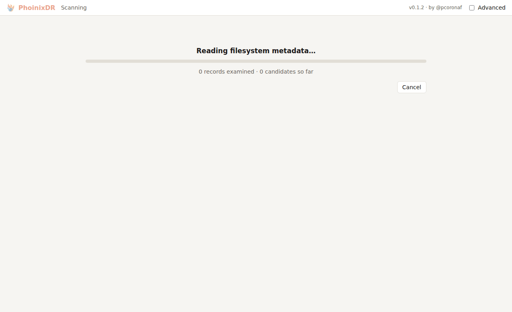
  <figcaption>Escaneo en curso: fase, recuentos y velocidad, con un botón Cancel que conserva los resultados parciales.</figcaption>
</figure>

El progreso muestra la fase, los recuentos y el rendimiento. Un escaneo
profundo tiene dos etapas de tallado, cada una con su propio progreso: la
**búsqueda de cabeceras** lee el espacio libre una vez (bytes escaneados)
y después **Examining carved files** (examinando archivos tallados) vuelve a
cada coincidencia para ensamblar, validar y puntuar el archivo
(coincidencias examinadas). La segunda etapa lee de nuevo la fuente,
coincidencia a coincidencia; su línea de progreso muestra los bytes leídos.
El escaneo puede cancelarse en cualquier fase; lo encontrado hasta ese
momento se conserva y se guarda como sesión parcial.

Una región que el dispositivo se niega a leer (un error de E/S o un tiempo
de espera del controlador) no detiene el escaneo: se reintenta en bloques
más pequeños, lo que sigue fallando se omite y se trata como ceros, la
página de progreso y el resumen de resultados indican cuánto no pudo
leerse, y un archivo tallado que se solapa con una región así lo dice en su
evidencia. El examen del contenido lee como mucho unos pocos megabytes por
archivo tallado; el muestreo de ceros, que detecta clústeres descartados o
borrados, se ejecuta con independencia de la opción *Examine content*.

## 4. Resultados

<figure>
  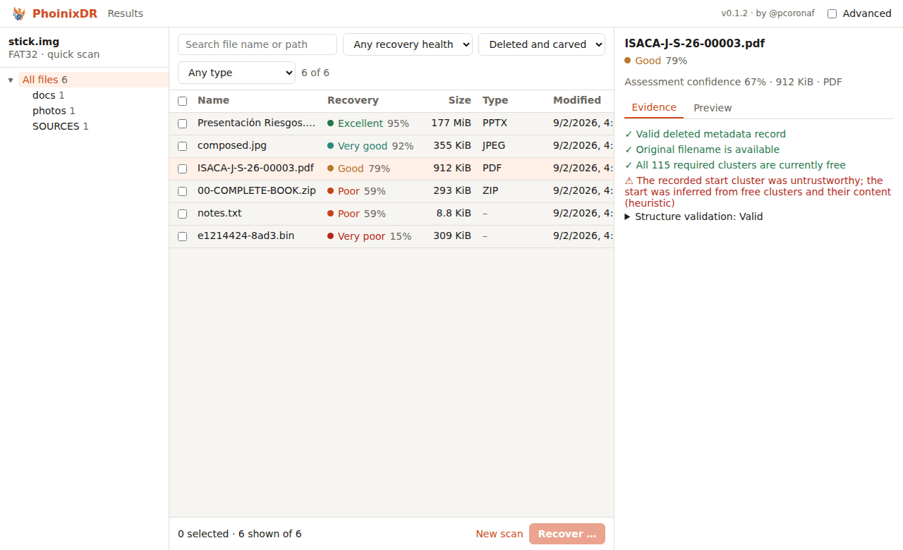
  <figcaption>Resultados: cada candidato con su salud de recuperación; el panel de la derecha lista la evidencia detrás de los números del archivo seleccionado.</figcaption>
</figure>

Cada fila es un candidato de recuperación:

| columna | significado |
|---|---|
| name | nombre original, o un nombre sintético `carved-…` para los archivos tallados |
| health | **probabilidad** de que la recuperación devuelva los bytes originales, con su categoría (Excellent … Unrecoverable), y **confianza** en esa estimación |
| size | tamaño lógico cuando se conoce |
| type | tipo de archivo detectado o esperado |
| path | ruta original; `(uncertain)` cuando el registro del directorio se reutilizó; las etiquetas `journal` y `carved` indican cómo se encontró el archivo |

Los filtros reducen la lista por texto, categoría de salud, tipo y origen
(metadatos o tallado). Al seleccionar una fila se abre el panel de
detalle:

- la **evidencia**: cada razón positiva y negativa detrás de los dos
  números, y diagnósticos como clústeres reutilizados, transacciones del
  diario o inicios inferidos;
- una **previsualización**: las imágenes se muestran, el texto se lee, el
  resto se vuelca en hexadecimal; las previsualizaciones leen la fuente,
  nunca la escriben.

Lea la evidencia antes de confiar en un número. «Allocated to active
filesystem data» significa que los clústeres se han reutilizado, no que
todos los bytes hayan desaparecido; «Unrecoverable» significa que no se
pudo localizar ninguna extensión del contenido, en cuyo caso un escaneo
profundo todavía puede tallarlo.

<figure>
  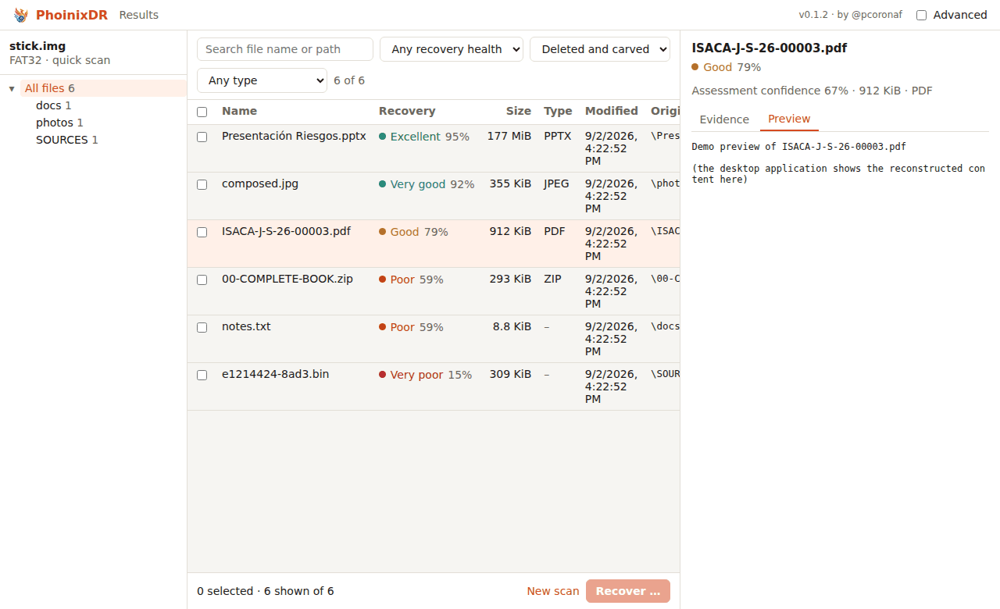
  <figcaption>La pestaña Preview muestra imágenes y texto y vuelca en hexadecimal el resto; solo lee de la fuente.</figcaption>
</figure>

## 5. Recuperación

<figure>
  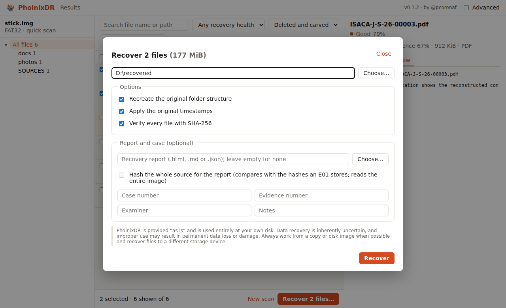
  <figcaption>El diálogo Recover: destino en otro disco, opciones y los campos opcionales de informe y caso.</figcaption>
</figure>

Seleccione filas y pulse **Recover**:

- **Destino:** un directorio en otro disco. Un destino en el disco de
  origen se rechaza; la anulación para expertos es para quien sabe que
  arriesga los datos que está recuperando. Un destino que sea el propio
  archivo de imagen se rechaza siempre.
- **Opciones:** recrear la estructura de carpetas original, aplicar las
  marcas de tiempo originales, verificar cada archivo con SHA-256.
- **Report and case (optional)** (informe y caso, opcional): elija un archivo de informe
  (`.html`, `.md` o `.json`), opcionalmente calcule el hash de toda la
  fuente para el informe, y rellene número de caso, número de evidencia,
  examinador y notas. Los campos se rellenan previamente con la cabecera de
  adquisición del E01 cuando la fuente tiene una.

La tabla de resultados muestra cada archivo con los bytes escritos,
`verified` o `PARTIAL`, el prefijo del SHA-256 y la ruta de salida. La
ruta del informe se muestra cuando se ha escrito uno.

<figure>
  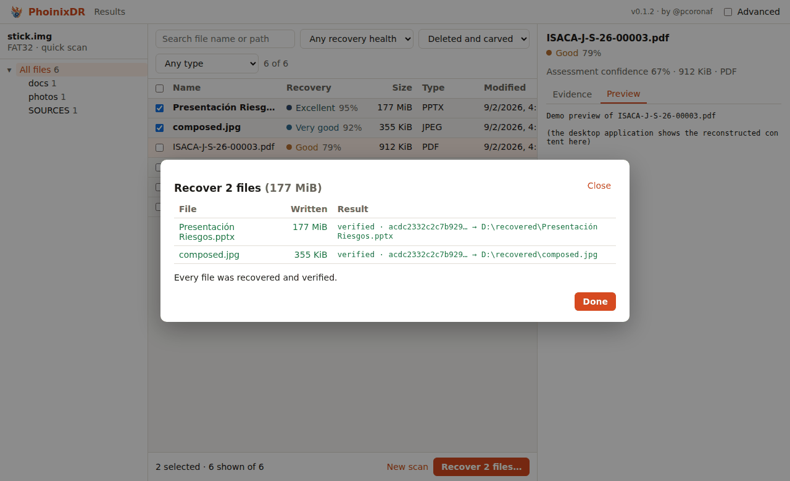
  <figcaption>Tras la recuperación: bytes escritos, estado de verificación y ruta de salida de cada archivo.</figcaption>
</figure>

## Modo avanzado

La casilla **Advanced** (avanzado) de la barra superior muestra el detalle
técnico que hay detrás de la interfaz. No cambia nada del escaneo ni de la
recuperación.

<figure>
  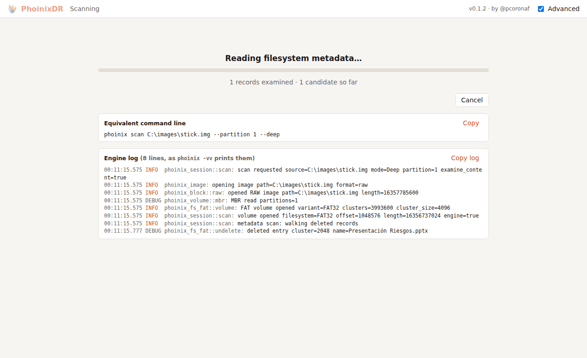
  <figcaption>Escaneo en modo avanzado: la línea de comandos equivalente sobre el registro del motor en directo.</figcaption>
</figure>

- **Línea de comandos equivalente.** Mientras se escanea, la página muestra
  el comando `phoinix scan …` que lo reproduce, con la misma fuente,
  partición, modo y opciones de tallado. En los resultados, el panel de
  detalle muestra los comandos `phoinix explain` y `phoinix recover` del
  archivo seleccionado. Cada comando tiene un botón *Copy* (copiar).
- **Registro del motor.** Los mismos registros que la línea de comandos
  imprime con `-vv`: qué imagen o dispositivo se abrió, el sistema de
  archivos encontrado, cuántos registros se recorrieron, la pasada de
  tallado y los recuentos finales. El registro se reenvía desde el motor
  solo mientras Advanced está activado; la aplicación de escritorio nunca lo
  escribe en disco y nunca contiene contenido recuperado. *Copy log* lo deja
  en el portapapeles para un informe de error, y la página de resultados
  conserva después *Copy scan log*.
- **En los resultados:** una columna *Ref* con la referencia del candidato
  en el sistema de archivos (el valor que usan los comandos anteriores), las
  comprobaciones de validación de estructura desplegadas y un bloque de
  diagnóstico con la evidencia en bruto (objeto, extensiones, asignación,
  muestras de contenido, marcas de tiempo, almacenamiento).

<figure>
  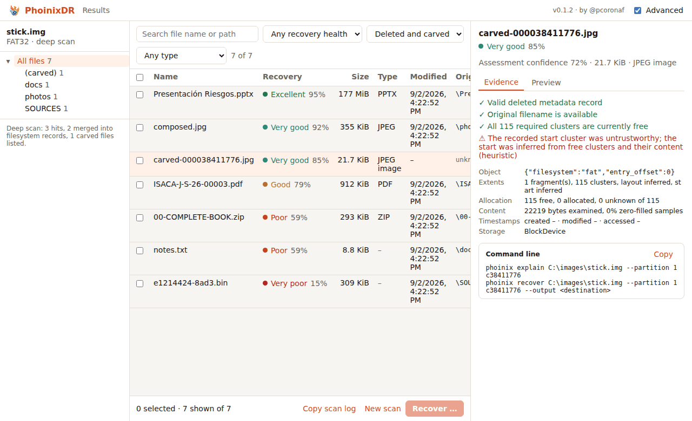
  <figcaption>Resultados en modo avanzado: la columna Ref, el bloque de diagnóstico y las líneas de comandos del archivo seleccionado.</figcaption>
</figure>

## Borrado seguro

PhoinixDR también puede hacer lo contrario de recuperar: sobrescribir un
disco completo, una partición o el espacio libre de un volumen para que no
pueda recuperarse nada de lo borrado, verificar el resultado, examinarlo
con sus propios motores de recuperación y emitir un certificado de
sanitización. Es un modo
aparte, accesible solo desde la página de inicio, con su propio color, y es
la única parte de PhoinixDR que escribe en un dispositivo (véase
[ADR-0014](../../decisions/ADR-0014-secure-erase-as-a-separate-write-crate.md),
en inglés). Todo lo que escribe se pierde para siempre; lea los avisos de
cada página.

<figure>
  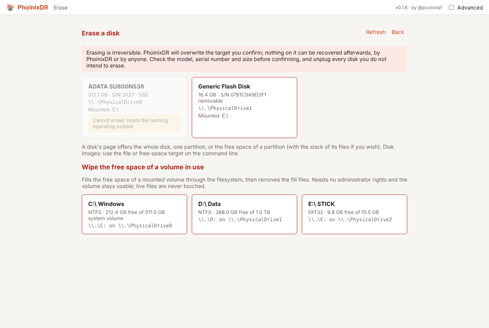
  <figcaption>Erase a disk (borrar un disco): cada disco con su modelo, número de serie y tamaño, y los que no pueden borrarse indican por qué; debajo, los volúmenes en uso cuyo espacio libre puede borrarse a través del sistema de archivos.</figcaption>
</figure>

1. **Elija el disco.** Se rechazan el disco del sistema, el disco desde el
   que se ejecuta el programa, el que guarda el directorio de sesiones y
   cualquier fuente abierta para recuperación. Los discos con volúmenes
   montados se listan con sus letras de unidad; en Windows los volúmenes se
   bloquean y desmontan antes de la primera escritura, en Linux debe
   desmontarlos usted antes. Cuando un disco indica que no es accesible
   desde este proceso, la página ofrece el mismo botón *Restart as
   administrator* que las páginas de recuperación.
2. **Elija qué borrar:** el disco completo, tabla de particiones incluida;
   una partición (su entrada en la tabla se conserva); o *solo el espacio
   libre* de una partición, que sobrescribe cada clúster que el sistema de
   archivos marca como libre y deja los archivos en su sitio (véase
   [Espacio libre](#espacio-libre) más abajo).
3. **Elija el método.** El predeterminado, una pasada de ceros, es el
   *Clear* de NIST SP 800-88 y basta en cualquier disco fabricado en este
   siglo. Los demás métodos se listan con lo que valen: *random*, *NIST*
   (aleatorio más la verificación que pide 800-88), las secuencias DoD
   5220.22-M (obsoletas desde 2007), Schneier, VSITR y Gutmann. Elegir un
   método de más de una pasada muestra un aviso: las pasadas adicionales
   añaden tiempo y desgaste, no seguridad, como dicen el epílogo del propio
   Gutmann y NIST 800-88; lea
   [El mito de Gutmann](https://www.pcoronaf.com/2014/07/el-mito-de-gutmann.html)
   (pcoronaf, 2014). Se ofrecen porque algunas políticas todavía los exigen.
4. **Dispositivos de estado sólido.** Una sobreescritura llega a los
   bloques lógicos, no a las celdas físicas: el controlador reasigna las
   escrituras y las celdas de sobreaprovisionamiento o retiradas nunca se
   tocan. En un SSD o una memoria USB la página lo advierte; una
   sobreescritura es un borrado a nivel de software, suficiente contra el
   software de recuperación, y un *purge* real necesita el comando de
   sanitización del propio dispositivo (previsto en M12.4) o la
   destrucción física.
5. **Verificación.** Tras la última pasada PhoinixDR relee el objetivo a
   través de su pila de recuperación de solo lectura y lo compara con lo
   escrito: todos los bloques en objetivos de menos de 1 GB, una muestra
   repartida de 4096 bloques en los demás, o todo si elige *Read back
   everything*. Las pasadas aleatorias también se verifican: la semilla de
   la ejecución queda registrada y los datos se regeneran para comparar.
6. **Escaneo posterior.** Opcionalmente, tras la verificación, PhoinixDR
   examina el objetivo con sus propios motores de recuperación: un
   *escaneo rápido* recorre los metadatos del sistema de archivos y cuenta
   los registros borrados cuyo contenido sigue siendo distinto de ceros;
   un *escaneo profundo* además talla por firmas el espacio borrado, lo
   que tarda tanto como un escaneo de recuperación. El certificado anota
   lo que encontró el escaneo. Tras sobrescribir un disco o una partición
   completa el resultado esperado es «ningún sistema de archivos»; tras un
   borrado de espacio libre, «ningún registro con contenido y nada
   tallado».
7. **Certificado.** Opcionalmente elija un archivo (`.html`, `.md` o
   `.json`) y rellene operador, organización, número de activo y notas. El
   certificado es un registro conforme a NIST SP 800-88 §4.8: modelo,
   número de serie y capacidad del dispositivo, rango borrado (o el
   volumen, su espacio libre y su slack), método y pasadas, horas, bytes
   escritos, resultado de la verificación, escaneo posterior y cada región
   que el dispositivo se negó a escribir (esos bytes no están borrados, y
   el certificado lo dice).
8. **Confirme.** Escriba el número de serie del dispositivo (o sus seis
   últimos caracteres) y pulse *Erase*. Sigue una cuenta atrás de cinco
   segundos durante la cual *Cancel* es el único control.

<figure>
  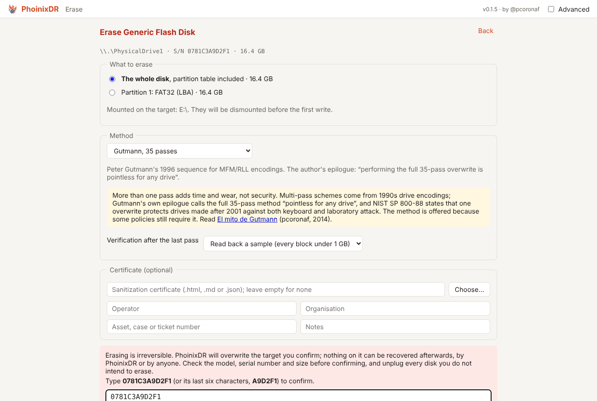
  <figcaption>Configuración: qué borrar, el método con su nota y el aviso de multipasada, los campos del certificado y la confirmación por número de serie.</figcaption>
</figure>

<figure>
  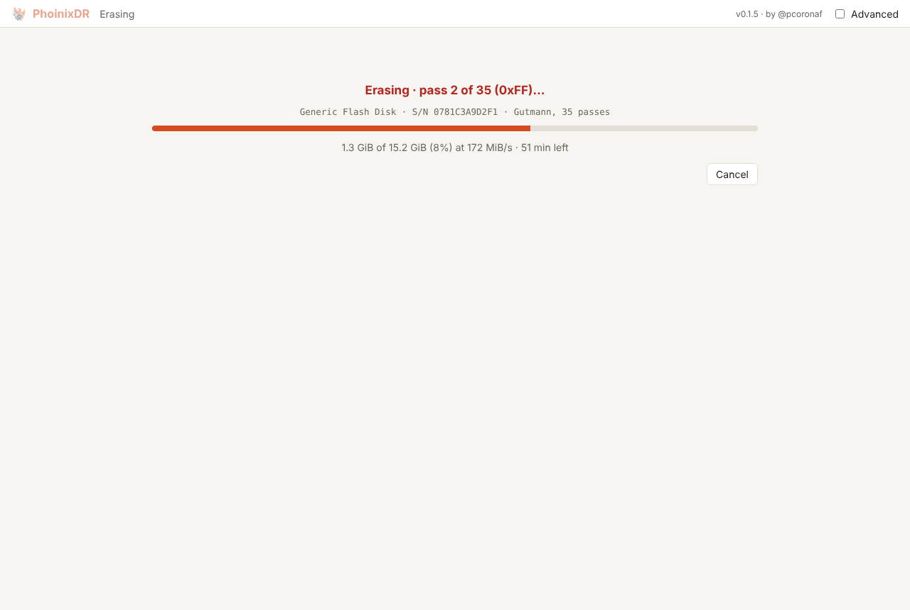
  <figcaption>Progreso: pasada, bytes escritos, velocidad y tiempo restante. Cancel se detiene tras el bloque en curso.</figcaption>
</figure>

Cancelar deja el objetivo parcialmente borrado y ofrece reanudar desde el
último bloque escrito, con la misma semilla, de modo que el certificado
sigue describiendo una ejecución completa. Una región que el dispositivo se
niega a escribir se reintenta en bloques más pequeños, se da por perdida y
se lista en el certificado. Un disco que falla es, por tanto, un disco
*incompletamente borrado*: si los datos no deben salir de su control,
destrúyalo.

<figure>
  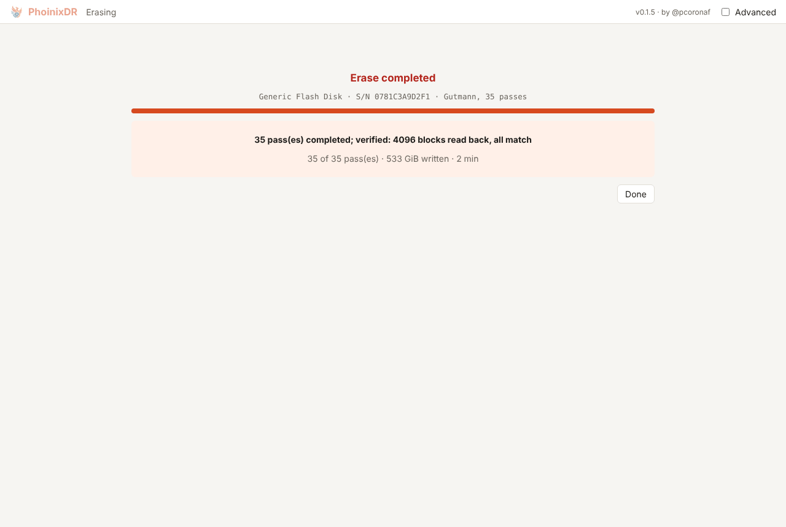
  <figcaption>Fin: el veredicto, las pasadas y los bytes escritos, y la ruta del certificado.</figcaption>
</figure>

### Espacio libre

Eliminar un archivo libera sus clústeres; los datos siguen ahí hasta que
algo los sobrescribe, que es exactamente lo que aprovecha la recuperación.
Un borrado de espacio libre sobrescribe esos clústeres y nada más, de modo
que el volumen sigue funcionando y sus archivos se conservan. PhoinixDR lo
ofrece de dos maneras.

**Desde la página del disco** (en bruto): elija *Only the free space of
partition N*. El volumen se lee con el mismo motor NTFS, FAT, exFAT o ext
que usa la recuperación, su mapa de asignación da los rangos libres, y la
página muestra cuántos bytes en cuántos rangos se escribirán. Marque *Also
overwrite the slack at the end of every file* para incluir los bytes entre
el final del contenido de cada archivo y el final de su último clúster,
donde sobreviven fragmentos de archivos anteriores; el slack se toma solo
de archivos vivos con una disposición simple y completa (sin flujos
comprimidos, dispersos, cifrados ni residentes). El volumen no debe estar
en uso: en Windows se desmonta mientras dura la operación, en Linux debe
desmontarlo usted antes. Este modo necesita derechos de administrador como
todo objetivo en bruto.

<figure>
  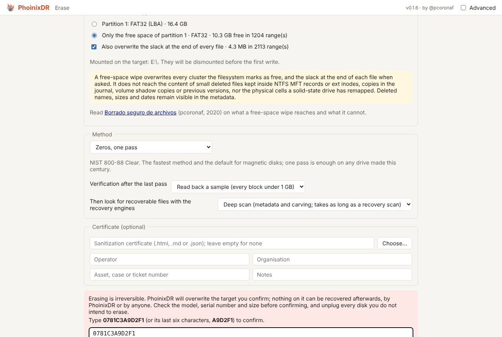
  <figcaption>Espacio libre de una partición, con el slack de sus archivos y un escaneo profundo posterior.</figcaption>
</figure>

**Desde un volumen en uso** (a través del sistema de archivos): la segunda
lista de la página de borrado muestra los volúmenes montados. Elegir uno
llena su espacio libre con archivos escritos a través del sistema de
archivos hasta que el volumen se llena, los reescribe en cada pasada
adicional, los relee y los elimina. No necesita derechos de administrador
y el volumen sigue utilizable, pero queda lleno un momento, así que cierre
antes los demás programas; *Leave free* reserva algo de espacio. Alcanza lo
que el sistema de archivos declara libre, algo menos que el modo en bruto:
el sistema de archivos se reserva algunos clústeres.

<figure>
  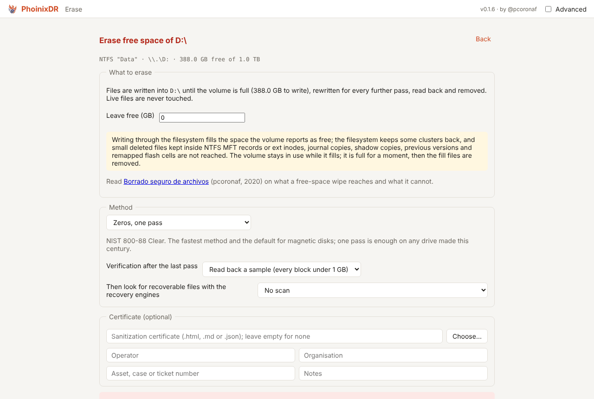
  <figcaption>El espacio libre de un volumen en uso: se escriben archivos hasta llenar el volumen y después se eliminan.</figcaption>
</figure>

<figure>
  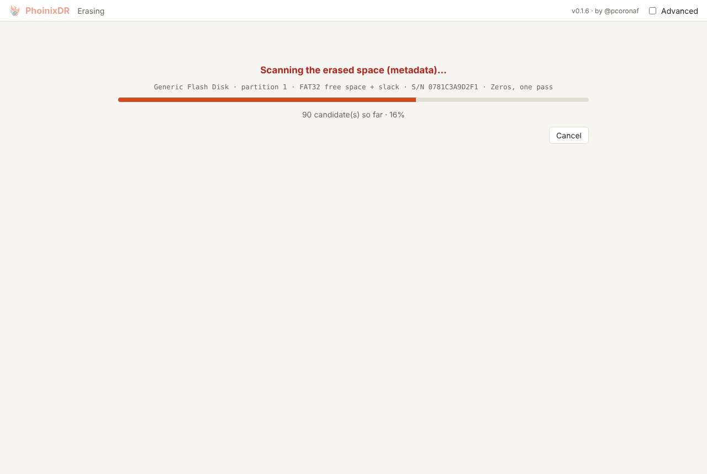
  <figcaption>Tras las pasadas y la relectura, el escaneo posterior busca archivos recuperables con los motores de recuperación.</figcaption>
</figure>

<figure>
  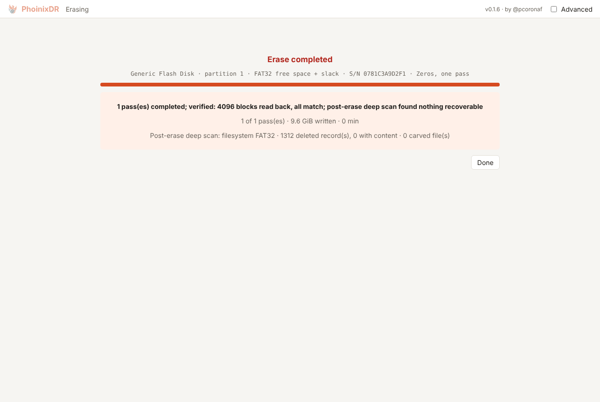
  <figcaption>Fin: la verificación y el escaneo posterior, con el sistema de archivos, los registros borrados encontrados, cuántos conservaban contenido y los archivos tallados.</figcaption>
</figure>

Ningún modo lo alcanza todo, y la página lo dice: el contenido de los
archivos borrados pequeños que NTFS guarda dentro de sus registros MFT (y
ext dentro de los inodos), las copias en el diario, las instantáneas de
volumen y versiones anteriores, y las celdas físicas que un disco de
estado sólido ha reasignado quedan como están, y los nombres, tamaños y
fechas borrados siguen visibles en los metadatos. El escaneo rápido
posterior informa de los registros residentes con contenido que encuentra,
para que el certificado sea honesto con ellos. Lea
[Borrado seguro de archivos](https://www.pcoronaf.com/2020/12/borrado-seguro-de-archivos.html)
(pcoronaf, 2020): sobrescribir un archivo por su nombre no alcanza las
copias que guarda el sistema, y la forma honesta de borrar un archivo es
borrar después el espacio libre de su volumen.

Borrar archivos y carpetas sueltos, y los comandos de sanitización del
firmware para SSD, son las siguientes partes del plan
([M12](../../erase/plan.md), en inglés).

## Sesiones

Cada escaneo se guarda como sesión (`.phx`) en el directorio de datos de
la aplicación y se lista en la página de inicio. Reabrir una sesión vuelve
a abrir la fuente en el mismo volumen (reparaciones incluidas), de modo
que las previsualizaciones y la recuperación funcionan después sin volver
a escanear. Las sesiones pueden abrirse desde cualquier ruta con
*Browse…*.

## Privacidad

La aplicación no se conecta a la red. Los registros (`-v` en la línea de
comandos, ninguno en la aplicación de escritorio) nunca contienen el
contenido recuperado.
