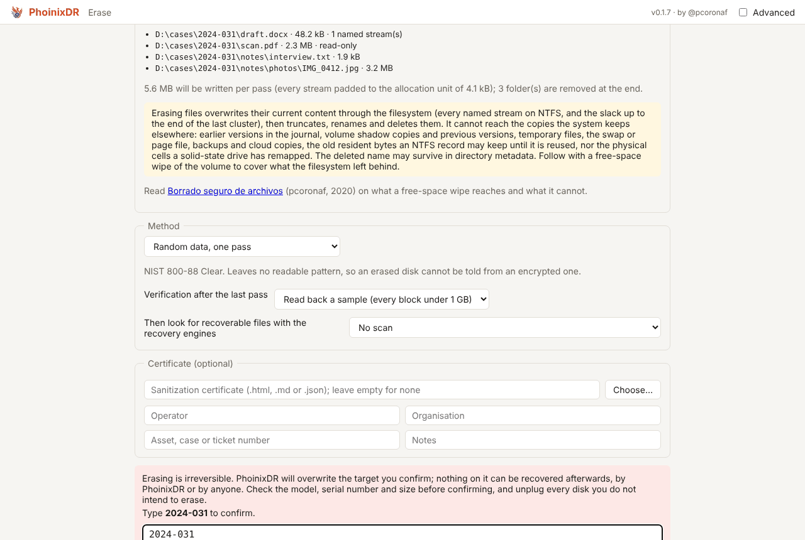

# Desktop guide

PhoinixDR's desktop application walks through the same steps as the
command line: choose a source, scan, understand what was found, preview,
recover. It never writes to the source.

## Starting

<figure>
  
  <figcaption>The home page: choose a physical disk, a removable device or a disk image; recent sessions are listed below.</figcaption>
</figure>

- **Windows:** run `PhoinixDR-<version>-windows-x64-portable.exe`. Nothing is
  installed (see [Windows portable release](../release/windows-portable.md)).
  To scan a physical disk or a USB stick, right-click the executable and
  choose *Run as administrator*; disk images do not need that.
- **Linux:** run `phoinix-desktop`; physical devices need `sudo` or a
  udev rule that grants read access to the disks.

The home page shows the version and author in the top bar and lists recent
scan sessions. A session of a physical device is labelled with the drive's
model and serial number, so scans of different drives that occupied the
same device path are told apart.

## Two ways to recover

PhoinixDR can work on the device itself or on an image of it. Pick one
before you start; the desktop guide below applies to both:

1. **Directly from the device, in one step.** Choose *Physical disk* or
   *Removable device*; when the device shows as not accessible, press
   **Restart as administrator** and accept the system prompt (or start
   PhoinixDR elevated yourself: Windows right-click, *Run as
   administrator*; Linux `sudo`). Then scan and recover. Fastest; PhoinixDR only ever reads from the device.
2. **From a disk image.** First make an image of the device with an
   imaging tool (FTK Imager or Arsenal Image Mounter on Windows, `dd`
   or `ewfacquire` on Linux) and then open the image file in PhoinixDR
   with *Disk image*. PhoinixDR itself needs no elevation for this; the
   imaging tool does, since it reads the same raw device. This is the
   recommended path for a failing drive, for anything you may need to
   examine again, and for forensic work (E01 hashes are verified and
   reported).

Both paths give the same results on a healthy device. In both, recover to
a different disk than the one you are recovering from.

## 1. Choose a source

<figure>
  
  <figcaption>The device picker. A disk that cannot be opened is greyed out and the notice offers to restart with administrator rights.</figcaption>
</figure>

| choice | what it lists |
|---|---|
| **Physical disk** | internal drives and SSDs |
| **Removable device** | USB sticks, SD cards, external disks |
| **Disk image** | a file: RAW/dd, split RAW, E01 (and split E01), SMART, VHD, VHDX, VMDK |

A device that cannot be opened is shown greyed as *Not accessible from
this process*, and a notice offers **Restart as administrator**: PhoinixDR
asks the system for elevation (the Windows UAC prompt, the polkit password
dialog on Linux) and starts an elevated copy of itself. On Windows the
current window closes as soon as the new one starts; on Linux it stays
open until the new window appears. Declining the prompt leaves the current
window as it was. The same notice appears on the home page when no device
can be listed at all. Starting the executable with *Run as administrator*
or `sudo` yourself works too. Disk images never need elevation.

## 2. Scan setup

<figure>
  
  <figcaption>Scan setup: the detected volume, the lost-partition search, Quick or Deep Scan, and content examination.</figcaption>
</figure>

The setup page shows the source, its partition table and every volume with
its filesystem and detection confidence.

- **Image container** (image files only): format, variant, segment count,
  compression, the acquisition header of an E01 (case number, examiner,
  dates, software), stored hashes, and a **Verify hashes** button that
  reads the whole image and compares its MD5/SHA-1 with the stored ones.
- **Volume:** pick a partition when the source has several.
- **Lost partitions:** *Search for lost partitions* scans the whole source
  for filesystem structures independently of the table. A found volume can
  be selected and is mounted virtually; when its primary boot sector is
  destroyed the backup is used in memory. The partition table is never
  modified.
- **Mode:** *Quick Scan* reads filesystem metadata (deleted files and
  records). *Deep Scan* also carves the unallocated space for files by
  signature; it reads the free space once. Volumes without a recognised
  filesystem can only be deep-scanned.
- **Deep scan options:** carve the whole volume instead of only the free
  space; restrict the file types.
- **Assessment:** *Examine content* validates file structures (JPEG, PNG,
  PDF, ZIP/DOCX, …) and raises assessment confidence; turning it off is
  faster.

## 3. Scanning

<figure>
  
  <figcaption>Scanning: phase, counts and throughput, with a Cancel button that keeps partial results.</figcaption>
</figure>

Progress shows the phase, counts and throughput. A deep scan has two
carving stages, each with its own progress: the **header search** reads the
free space once (bytes scanned), then **Examining carved files** goes back
to every hit to assemble, validate and score the file (hits examined). The
second stage reads the source again one hit at a time; its progress line
shows the bytes read. The scan can be cancelled in any phase; whatever was
found so far is kept and saved as a partial session.

A region the device refuses to read (an I/O error or a driver timeout) does
not stop the scan: it is retried in smaller blocks, what still fails is
skipped and treated as zeros, the progress page and the results summary
report how much was unreadable, and a carved file that overlaps such a
region says so in its evidence. Content examination reads at most a few
megabytes per carved file; zero sampling, which detects discarded or wiped
clusters, runs regardless of the *Examine content* option.

## 4. Results

<figure>
  
  <figcaption>Results: every candidate with its recovery health; the panel on the right lists the evidence behind the selected file's numbers.</figcaption>
</figure>

Every row is a recovery candidate:

| column | meaning |
|---|---|
| name | original name, or a synthetic `carved-…` name for carved files |
| health | **likelihood** that recovery returns the original bytes, with its category (Excellent … Unrecoverable), and **confidence** in that estimate |
| size | logical size when known |
| type | detected or expected file type |
| path | original path; `(uncertain)` when the directory record was reused; `journal` and `carved` tags say how the file was found |

Filters narrow the list by text, health category, type and origin
(metadata or carved). Selecting a row opens the detail panel:

- the **evidence**: every positive and negative reason behind the two
  numbers, and diagnostics such as reused clusters, journal transactions
  or inferred starts;
- a **preview**: images are rendered, text is shown, other content is
  hex-dumped; previews read the source, never write it.

Read the evidence before trusting a number. "Allocated to active
filesystem data" means the clusters have been reused, not that every
byte is gone; "Unrecoverable" means no extent of the content could be
located, in which case a deep scan may still carve it.

<figure>
  
  <figcaption>The Preview tab renders images and text and hex-dumps other content, reading only from the source.</figcaption>
</figure>

## 5. Recovery

<figure>
  
  <figcaption>The Recover dialog: destination on another disk, options, and the optional report and case fields.</figcaption>
</figure>

Select rows and press **Recover**:

- **Destination:** a directory on another disk. A destination on the
  source disk is refused; the expert override is for people who know they
  are risking the data they are recovering. A destination that is the
  image file itself is always refused.
- **Options:** recreate the original folder structure, apply original
  timestamps, verify every file with SHA-256.
- **Report and case (optional):** choose a report file (`.html`, `.md` or `.json`),
  optionally hash the whole source for it, and fill in case number,
  evidence number, examiner and notes. Fields are prefilled from the E01
  acquisition header when the source has one.

The result table shows every file with bytes written, `verified` or
`PARTIAL`, the SHA-256 prefix and the output path. The report path is
shown when one was written.

<figure>
  
  <figcaption>After recovery: bytes written, verification state and output path for every file.</figcaption>
</figure>

## Advanced mode

The **Advanced** checkbox in the top bar shows the technical detail behind
the interface. It changes nothing about the scan or the recovery.

<figure>
  
  <figcaption>Scanning in Advanced mode: the equivalent command line above the live engine log.</figcaption>
</figure>

- **Equivalent command line.** While a scan runs, the page shows the
  `phoinix scan …` command that reproduces it, with the same source,
  partition, mode and carving options. In the results, the detail panel
  shows the `phoinix explain` and `phoinix recover` commands for the
  selected file. Every command has a *Copy* button.
- **Engine log.** The same records the command line prints with `-vv`:
  which image or device was opened, the filesystem found, how many records
  were walked, the carving pass, and the counts at the end. The log is
  forwarded from the engine only while Advanced is on; it is never
  written to disk by the desktop application and never contains recovered
  content. *Copy log* puts it on the clipboard for a bug report, and the
  results page keeps *Copy scan log* available afterwards.
- **In the results:** a *Ref* column with the candidate's filesystem
  reference (the value the commands above use), the structure validation
  checks expanded, and a diagnostics block with the raw evidence (object,
  extents, allocation, content samples, timestamps, storage).

<figure>
  
  <figcaption>Results in Advanced mode: the Ref column, the diagnostics block and the command lines for the selected file.</figcaption>
</figure>

## Secure erase

PhoinixDR can also do the opposite of recovery: overwrite a whole disk,
one partition or the free space of a volume so that nothing deleted can
be recovered, verify the result, look at the result with its own recovery
engines, and write a sanitization certificate. It is a separate mode, reachable
only from the home page, in a separate colour, and it is the only part of
PhoinixDR that writes to a device (see
[ADR-0014](../decisions/ADR-0014-secure-erase-as-a-separate-write-crate.md)).
Everything it writes is lost for good; read the warnings on each page.

<figure>
  
  <figcaption>Erase a disk: every disk with its model, serial number and size, the ones that cannot be erased saying why; below, the volumes in use whose free space can be wiped through the filesystem.</figcaption>
</figure>

1. **Choose the disk.** The system disk, the disk the executable runs
   from, the disk that holds the sessions directory and a source open for
   recovery are refused. Disks with mounted volumes are listed with their
   drive letters; on Windows the volumes are locked and dismounted before
   the first write, on Linux you unmount them first. When a disk says it
   is not accessible from this process, the page offers the same *Restart
   as administrator* button as the recovery pages.
2. **Choose what to erase:** the whole disk, partition table included;
   one partition (its table entry stays); or *only the free space* of a
   partition, which overwrites every cluster the filesystem marks as free
   and leaves the files in place (see [Free space](#free-space) below).
3. **Choose the method.** The default, one pass of zeros, is NIST SP 800-88
   *Clear* and is enough on any drive made this century. The other methods
   are listed with what they are worth: *random*, *NIST* (random plus the
   verification 800-88 asks for), the DoD 5220.22-M sequences (obsolete
   since 2007), Schneier, VSITR and Gutmann. Choosing any method with more
   than one pass shows a warning: the extra passes add time and wear, not
   security, as Gutmann's own epilogue and NIST 800-88 state; read
   [El mito de Gutmann](https://www.pcoronaf.com/2014/07/el-mito-de-gutmann.html)
   (pcoronaf, 2014). They are offered because some policies still require
   them.
4. **Solid-state devices.** An overwrite reaches the logical blocks, not
   the physical cells: the controller remaps writes, and over-provisioned
   or retired cells are never touched. On an SSD or a USB stick the page
   says so; an overwrite is a software-level clear, enough against
   recovery software, and a real purge needs the device's own sanitize
   command (planned for M12.4) or physical destruction.
5. **Verification.** After the last pass PhoinixDR reads the target back
   through its read-only recovery stack and compares it with what was
   written: every block for targets under 1 GB, a spread sample of 4096
   blocks otherwise, or everything if you choose *Read back everything*.
   Random passes are verifiable too: the run's seed is recorded and the
   data is regenerated for the comparison.
6. **Post-erase scan.** Optionally, after the verification, PhoinixDR
   looks at the target with its own recovery engines: a *quick scan* walks
   the filesystem metadata and counts the deleted records whose content is
   still something other than zeros; a *deep scan* also carves the erased
   space by signature, which takes as long as a recovery scan. The
   certificate records what the scan found. After a whole-disk or
   whole-partition overwrite the expected finding is "no filesystem"; after
   a free-space wipe it is "no record with content and nothing carved".
7. **Certificate.** Optionally choose a file (`.html`, `.md` or `.json`)
   and fill in operator, organisation, asset number and notes. The
   certificate is a NIST SP 800-88 §4.8 record: device model, serial number
   and capacity, target range (or the volume, its free space and slack),
   method and passes, times, bytes written, the verification result, the
   post-erase scan, and every region the device refused to write (those
   bytes are not erased, and the certificate says so).
8. **Confirm.** Type the device's serial number (or its last six
   characters) and press *Erase*. A five-second countdown follows during
   which *Cancel* is the only control.

<figure>
  
  <figcaption>Setup: what to erase, the method with its note and the multi-pass warning, the certificate fields and the serial-number confirmation.</figcaption>
</figure>

<figure>
  
  <figcaption>Progress: pass, bytes written, throughput and time left. Cancel stops after the current block.</figcaption>
</figure>

Cancelling leaves the target partially erased and offers to resume from
the last block written, with the same seed, so the certificate still
describes one complete run. A region the device refuses to write is
retried in smaller blocks, then written off and listed in the certificate.
A failing drive is therefore an *incompletely erased* drive: if the data
must not leave your control, destroy it.

<figure>
  
  <figcaption>Done: the verdict, the passes and bytes written, and the certificate path.</figcaption>
</figure>

### Free space

Deleting a file frees its clusters; the data stays there until something
overwrites it, which is exactly what recovery relies on. A free-space wipe
overwrites those clusters and nothing else, so the volume keeps working
and its files stay. PhoinixDR offers it in two ways.

**From the disk's page** (raw): choose *Only the free space of partition
N*. The volume is read with the same NTFS, FAT, exFAT or ext engine a
recovery uses, its allocation map gives the free ranges, and the page
shows how many bytes in how many ranges will be written. Tick *Also
overwrite the slack at the end of every file* to include the bytes between
the end of each file's content and the end of its last cluster, where
fragments of older files survive; slack is taken only from live files
whose layout is plain and complete (no compressed, sparse, encrypted or
resident streams). The volume must not be in use: on Windows it is
dismounted for the duration, on Linux you unmount it first. This mode needs
administrator rights like every raw target.

<figure>
  
  <figcaption>Free space of a partition, with the slack of its files and a deep post-erase scan.</figcaption>
</figure>

**From a volume in use** (through the filesystem): the second list on the
erase page shows the mounted volumes. Choosing one fills its free space
with files written through the filesystem until the volume is full,
rewrites them for every further pass, reads them back and removes them.
This needs no administrator rights and the volume stays usable, but it is
full for a moment, so close other programs first; *Leave free* keeps some
space back. It reaches what the filesystem reports as free, which is a
little less than the raw mode: the filesystem keeps some clusters for
itself.

<figure>
  
  <figcaption>The free space of a volume in use: files are written until the volume is full, then removed.</figcaption>
</figure>

<figure>
  
  <figcaption>After the passes and the read-back, the post-erase scan looks for recoverable files with the recovery engines.</figcaption>
</figure>

<figure>
  
  <figcaption>Done: the verification and the post-erase scan, with the filesystem, the deleted records found, how many still had content, and the carved files.</figcaption>
</figure>

Neither mode reaches everything, and the page says so: the content of
small deleted files that NTFS keeps inside their MFT records (and ext
inside inodes), copies in the journal, volume shadow copies and previous
versions, and the physical cells a solid-state drive has remapped are
left as they are, and the deleted names, sizes and dates stay visible in
the metadata. The post-erase quick scan reports the resident records it
finds with content so the certificate is honest about them. Read the
author's
[Borrado seguro de archivos](https://www.pcoronaf.com/2020/12/borrado-seguro-de-archivos.html)
(pcoronaf, 2020): overwriting a file by name does not reach the copies the
system keeps, and the honest way to erase a file is to wipe the free space
of its volume afterwards.

### Files and folders

The third list on the erase page erases files and folders by name:
*Choose files…* or *Choose a folder…*. Every file is overwritten through
the filesystem with the chosen method, named streams included on NTFS
(the *Zone.Identifier* a download carries, for instance), and padded to
the end of its last cluster so that its slack goes too; then it is read
back, truncated to zero length, renamed to a random name of the same
length and deleted, and the folders are removed once empty. The page
lists the files with their sizes, streams and read-only attributes
(cleared before writing), says how many bytes each pass writes, and the
certificate lists every file erased and every item that could not be.
Symbolic links are skipped, never followed, and the running PhoinixDR
executable is refused.

<figure>
  
  <figcaption>Files and folders: the list, what each pass writes, and what erasing by name cannot reach.</figcaption>
</figure>

This is the operation the author's
[Borrado seguro de archivos](https://www.pcoronaf.com/2020/12/borrado-seguro-de-archivos.html)
(pcoronaf, 2020) warns about, and the page says what it cannot reach:
earlier versions in the journal, volume shadow copies and previous
versions, temporary files, the swap or page file, backups and cloud
copies, the old resident bytes an NTFS record may keep until it is
reused, and the remapped cells of a solid-state drive; the deleted name
may survive in directory metadata. The honest sequence is therefore:
erase the files, then wipe the free space of their volume. The optional
post-erase scan counts only the erased names (it needs administrator
rights to read the volume).

The firmware sanitize commands for SSDs are the last part of the plan
([M12](../erase/plan.md)).

## Sessions

Every scan is saved as a session (`.phx`) in the application data
directory and listed on the home page. Reopening a session reopens the
source at the same volume (repairs included) so previews and recovery
work later without rescanning. Sessions can be opened from any path with
*Browse…*.

## Privacy

The application does not contact the network. Logs (`-v` on the command
line, none in the desktop) never contain recovered content.
